## Introduction

In [Part 1](/posts/damn-vulnerable-drone-part-1/) I finished the **Reconnaissance** stage: I cracked the WEP Wi-Fi to get onto the drone network (`192.168.13.0/24`), then used nmap and Wireshark to identify the Companion Computer (`192.168.13.1`) and the GCS (`192.168.13.14`) and their exposed services. That was the "drawing the map" phase. The three targets I flagged back then — `554` (RTSP camera), `14540`/`5760` (MAVLink), and `3000` (web) — are what I attack here.

Part 2 is four hands-on exercises:

1. **GPS Spoofing** (Protocol Tampering)
2. **Flight Mode Injection** (Injection)
3. **Companion Computer Web UI Login Brute Force** (Injection)
4. **Camera Feed Eavesdropping** (Exfiltration)

I'll be upfront: of these four, **only one succeeded cleanly like the textbook**. The rest were either "partial success + a limit discovered" or "the vulnerability is real, but the environment wouldn't let me reproduce the payoff." That mismatch, though, is exactly what makes the real structure of MAVLink/drone security visible. This post is not a success story — it's a record of **how far each attack actually reaches, and where it stops.**

### What changed from Part 1

Reconnaissance didn't care about the drone's flight state — port scans and traffic analysis worked whether the drone was powered off or airborne. Most Part 2 attacks are different: they only mean something when **the drone is in a particular flight state.** DVD triggers these from the management console (`http://localhost:8000`) — Initial Boot → Arm & Take-Off → Autopilot Flight → Emergency/RTH → Post-Flight — and each button is really the GCS issuing commands to the drone. So the shared precondition for every exercise below is **"get the drone flying before you attack."**

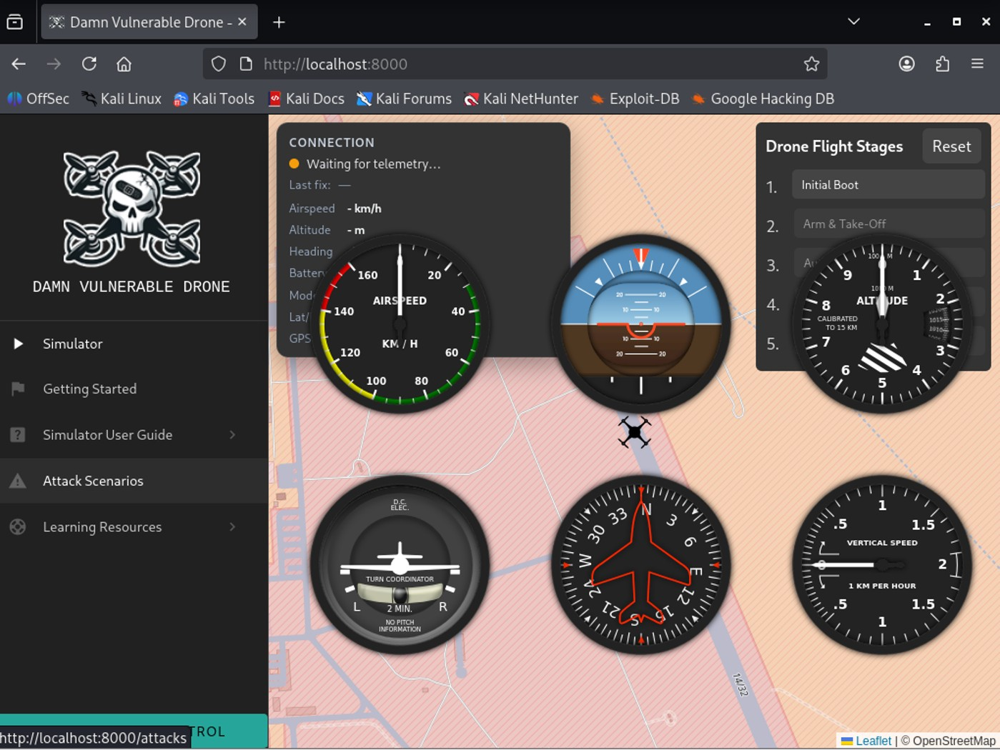
_Before any flight state is triggered: the console shows "Waiting for telemetry" and empty gauges. There's nothing to attack yet._

> Environment: Kali Linux on VMware, DVD in Lite mode + Wi-Fi (WEP). The attacker machine is `192.168.13.10`, obtained in Part 1.
{: .prompt-info }

---

## Exercise 1. GPS Spoofing — the limits of "deception"

### Goal

Send forged GPS data to the GCS repeatedly so the operator's view of the drone's position diverges from reality. It exploits the fact that MAVLink has no sender authentication — the most basic form of Protocol Tampering.

### Concept

The script is actually the same one I prototyped right after breaking in during Part 1. Using `pymavlink`, it crafts three message types and fires them at the GCS on UDP 14550:

- `HEARTBEAT` — pose as a live airframe
- `GPS_RAW_INT` — raw GPS (valid fix, 10 satellites, to look "trustworthy")
- `GLOBAL_POSITION_INT` — the fused position (the value drawn on the map)

The spoofed coordinate is latitude 47.35°, longitude 85.46° — more than 10 degrees away from the real position (near Area 51, latitude 37.24°).

First, the drone has to be airborne so there's real telemetry to override:

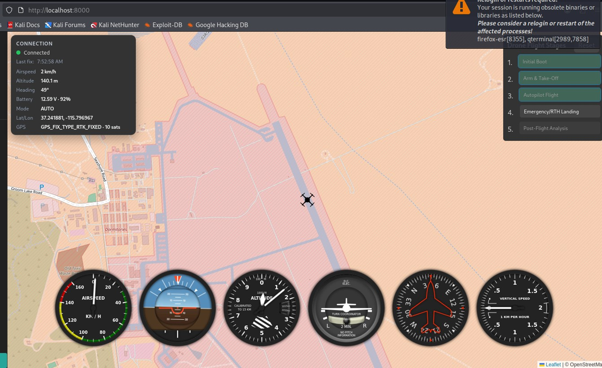
_Baseline before the attack: Connected, Mode AUTO, real Lat/Lon 37.241881, -115.796967. This is the "truth" the spoof has to overwrite._

### Running it

My first run used `time.sleep(0.2)` (5 packets/sec) and nothing moved on the map. The reason surfaced quickly — **the real telemetry was arriving more often than my spoof and drowning it out.** So I raised the rate:

```bash
sed -i 's/time.sleep(0.2)/time.sleep(0.02)/' attacks/gps-spoofing.py
sudo python3 attacks/gps-spoofing.py 192.168.13.14:14550
```

### Result: partial success

The GCS log showed clear evidence that the attack **was arriving**:

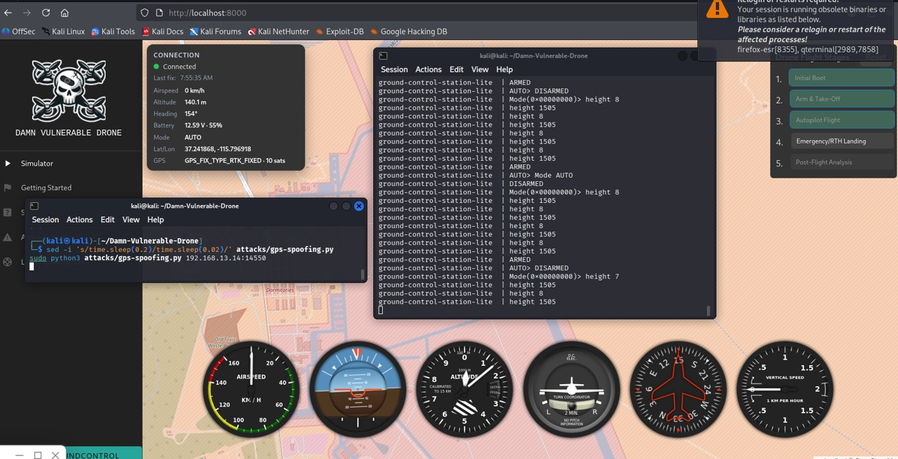
_The GCS log alternates between my forged values and the real ones — `height 1505` (my spoof) vs `height 8` (real), `ARMED` vs `DISARMED`. The GCS is receiving both streams and flip-flopping._

```
ground-control-station | Mode(0x00000000)> height 1505
ground-control-station | height 8
ground-control-station | height 1505
ground-control-station | ARMED
ground-control-station | AUTO> DISARMED
```

And yet **the Lat/Lon on the map never budged from 37.24°.** I launched QGroundControl to cross-check, and the result was identical — the drone icon stayed pinned to its real coordinates over Nellis Air Force Base.

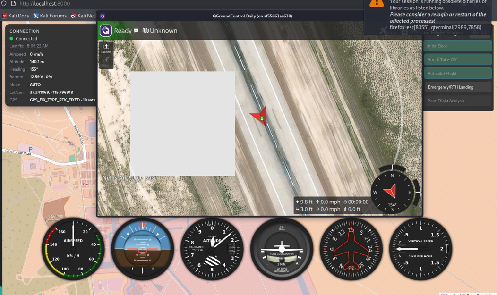
_QGroundControl, with the spoof still running: the aircraft stays at the real position. Altitude and mode wobbled; position did not._

### Why do altitude and mode shake, but position doesn't?

This is the key finding. Altitude (`height`) and state (`ARMED`/`mode`) shook under my packets, but **position (Lat/Lon) was rejected.** The reason is that the GCS doesn't trust position from a single `GLOBAL_POSITION_INT` value — it runs it through **EKF fusion and validation.** A coordinate that suddenly jumps 10 degrees fails the sanity check and gets discarded. Altitude and mode flags have much weaker cross-checking, so they shook freely.

> Takeaway: MAVLink spoofing is not an attack where "every field is equally easy to fake." Fields protected by sensor fusion (position) and fields that aren't (altitude, state) behave completely differently. Changing a fused position with single-message injection would need a more precise attack targeting `GPS_INPUT` or the EKF itself (→ GPS Data Injection).
{: .prompt-tip }

---

## Exercise 2. Flight Mode Injection — "making it obey"

### Goal

If Exercise 1 was about *deceiving what the operator sees*, this is about **injecting a command the drone actually obeys.** Using `COMMAND_LONG` / `MAV_CMD_DO_SET_MODE`, I change the flight mode without operator authorization.

### Tool choice: pymavlink instead of MAVProxy

The wiki walkthrough uses MAVProxy, but by this point my attacker machine was on the drone network and therefore **had no internet** (the drone gateway owns the default route), so I couldn't install MAVProxy. Instead I wrote a short `pymavlink` script that fires a single `COMMAND_LONG`. It's the same tool family as Exercise 1's spoofer, which also makes the "tamper script vs. inject script" contrast cleaner.

> A structural quirk of DVD Wi-Fi mode: the moment you join the drone network, your attacker machine's internet route is replaced by the drone gateway. Finish any external dependencies (tool installs) **before** you break in.
{: .prompt-warning }

### Snag: there are two airframes

Right after connecting I noticed something odd — the supported-modes list came back **different on each run**:

- Sometimes: `MANUAL, FBWA, QSTABILIZE, QLAND, AUTOLAND...` → **Plane/VTOL**, `sys=0`
- Sometimes: `STABILIZE, ALT_HOLD, LOITER, RTL, LAND, POSHOLD...` → **Copter**, `sys=1`

The network has two MAVLink heartbeat sources, and whichever one is latched first decides the airframe type and `target_system`. With `sys=0` latched, `LAND` returned "unsupported" (Plane uses `QLAND`); with `QLAND` it returned "unsupported" again (now latched as Copter, where `LAND` is correct). Round and round.

> Takeaway: before injecting a mode, you have to **identify the airframe first** via `mode_mapping()`. If you don't know whether the target is a Plane or a Copter, you'll get the mode name wrong. Reconnaissance doesn't end at the network layer — it continues down to the protocol layer.
{: .prompt-tip }

### Stabilize + success

To dodge this I changed the script two ways: (1) only accept a heartbeat where `sys >= 1`, and (2) use `set_mode_send` instead of `command_long` and **receive the `COMMAND_ACK`** to confirm the vehicle accepted it.

```python
while True:
    m.wait_heartbeat()
    if m.target_system >= 1:   # ignore sys=0 (aux node), keep the real vehicle
        break

mode_id = m.mode_mapping()[mode_name]
m.mav.set_mode_send(
    m.target_system,
    mavutil.mavlink.MAV_MODE_FLAG_CUSTOM_MODE_ENABLED,
    mode_id)
ack = m.recv_match(type='COMMAND_ACK', blocking=True, timeout=3)
```

RTL came back with an ACK but the console stayed on DRIFT (RTL transition needs conditions like a home position). Switching to `CIRCLE`, which transitions unconditionally, worked cleanly:

```bash
python3 attacks/mode-injection.py tcp:192.168.13.1:5760 CIRCLE
```

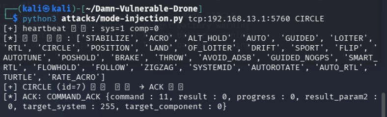
_The injection is accepted: `ACK: COMMAND_ACK {command : 11, result : 0, ...}`. `result : 0` is `MAV_RESULT_ACCEPTED` — the vehicle explicitly confirms the mode change._

And the management console reflected it:

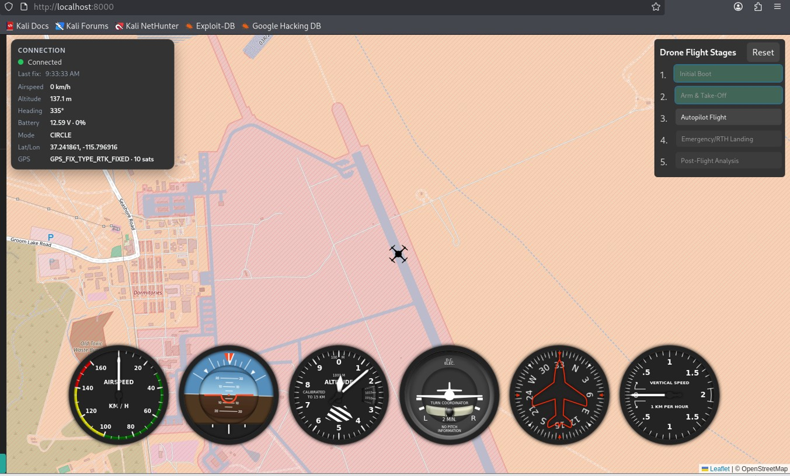
_Console Mode is now CIRCLE. The injected command took effect._

### The contrast with Exercise 1 — this is the core of Part 2

| | Exercise 1 (GPS Spoofing) | Exercise 2 (Flight Mode Injection) |
|---|---|---|
| Injected into | Observation (telemetry) | Control (command) |
| Message | `GLOBAL_POSITION_INT` | `MAV_CMD_DO_SET_MODE` |
| Result | Position **rejected** by EKF fusion | **ACCEPTED, applied immediately** |

MAVLink **filters observations through sensor fusion, but control commands have no sender authentication and are simply obeyed.** This asymmetry runs through all of Part 2. Paradoxically, *commanding* the drone (Exercise 2) was easier than *deceiving* it (Exercise 1).

---

## Exercise 3. Companion Web UI Brute Force — a plain web vulnerability

### Goal

Take port `3000` from Part 1 — the Companion Computer's management web login — and brute-force it to establish a foothold. Where Exercises 1 and 2 attacked MAVLink (a drone-specific protocol), this is **ordinary web hacking.**

### Recon: understand the form

I collected hydra's inputs straight from the browser DevTools. Logging in with `admin` / `test` and inspecting the failed request:

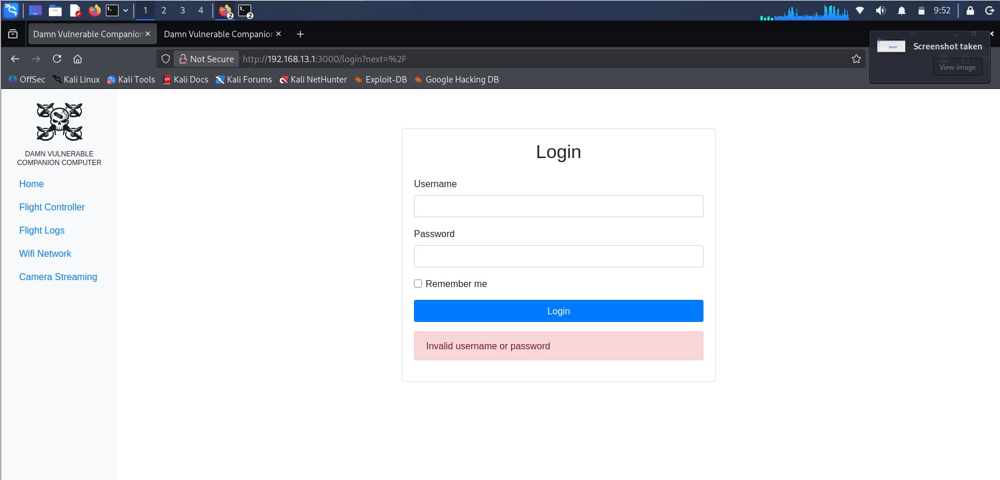
_The target: the Companion Computer login form, showing "Invalid username or password" on a failed attempt._

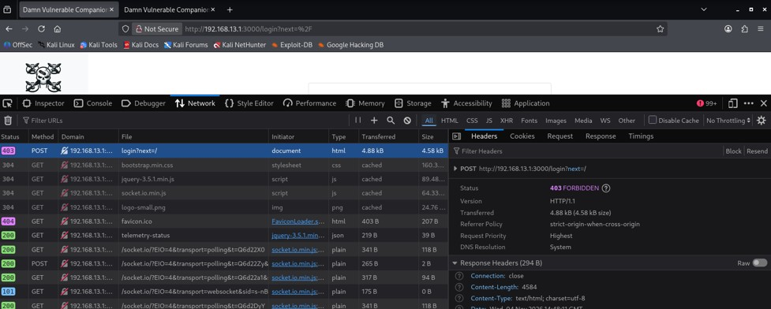
_Headers: the login is `POST /login`, and a failure returns HTTP `403 FORBIDDEN`._

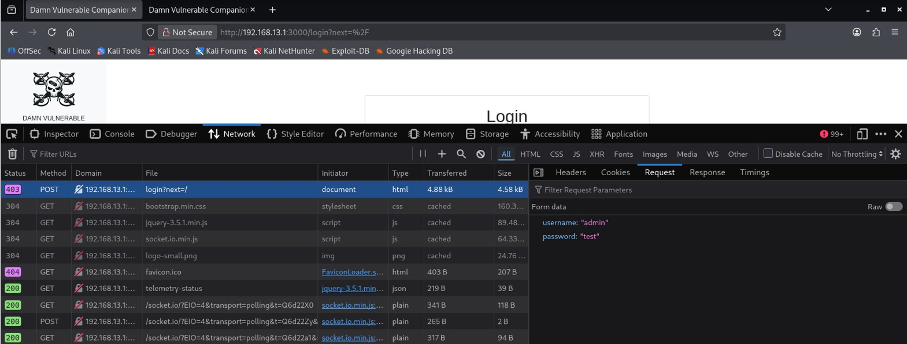
_Request form data confirms the field names: `username` and `password`._

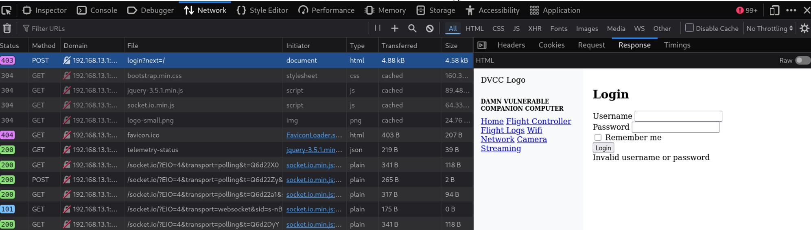
_Response body contains the failure string `Invalid username or password` — the marker hydra uses to detect a failed attempt._

So: endpoint `POST /login`, fields `username`/`password`, failure string `Invalid username or password` (plus a 403).

### Attack

DVD ships its own password list inside the repo (no internet needed). hydra against the `admin` account:

```bash
hydra -l admin \
  -P ~/Damn-Vulnerable-Drone/simulator/mgmt/templates/pages/attacks/injection/passwords.txt \
  -s 3000 192.168.13.1 http-post-form \
  "/login:username=^USER^&password=^PASS^:Invalid username or password"
```

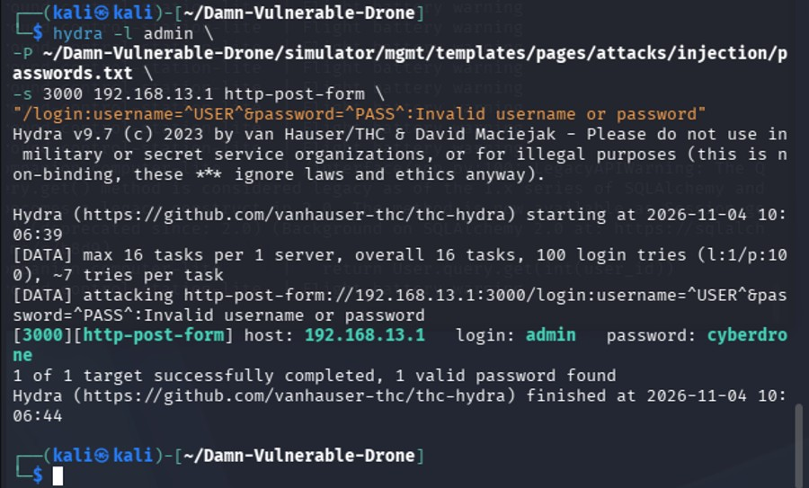
_hydra recovers the credentials within 100 tries: `login: admin password: cyberdrone`._

```
[3000][http-post-form] host: 192.168.13.1   login: admin   password: cyberdrone
1 of 1 target successfully completed, 1 valid password found
```

Logging in lands on the Companion Computer Web Interface, which even exposes its Current Config:

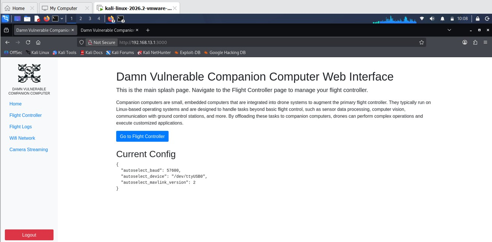
_Foothold established. The dashboard leaks the Current Config: `autoselect_baud: 57600`, `/dev/ttyUSB0`, `mavlink_version: 2`._

### What it proves

The management web (3000) on this little Linux box strapped to the drone uses credentials weak enough to fall to a common password list — and, more importantly, it has **no rate limiting or account lockout**, so unlimited guessing works. This is where the drone's attack surface moves from "a dedicated protocol (MAVLink)" to "an ordinary IT weakness (weak web auth)." A Companion Computer is, after all, a Linux server, so the usual web weaknesses exist on it too.

And this login isn't the end — it's the gateway. The menu inside the web UI — Flight Controller / Flight Logs / **Camera Streaming** — is the entry point for what comes next.

---

## Exercise 4. Camera Feed Eavesdropping — vulnerability present, payoff not reproduced

### Goal

Grab what "Camera Streaming" from Exercise 3 points at: the RTSP stream on port `554`, carrying the drone's onboard camera feed. It's the Exfiltration piece, and it bookends Part 1's WEP break-in (coming in over the air) — "take the drone's eyes too."

### Running it

```bash
ffplay rtsp://192.168.13.1:554/stream1
```

> RTSP's default port is 554, so `rtsp://host/stream1` with no port still connects to 554 (same idea as HTTP 80 / HTTPS 443). You only need to spell out the port if the server uses a non-standard one (e.g. 8554).
{: .prompt-info }

### Result: a 503, and an honest failure

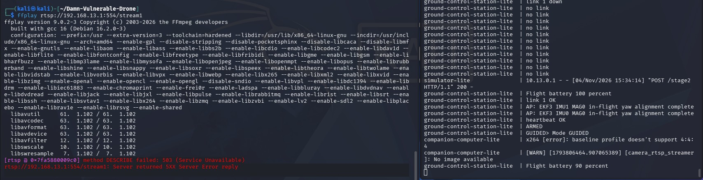
_The RTSP server is reachable (it answered DESCRIBE), but returns 503. The companion log shows why: `No image available` and an x264 encoder error._

```
[rtsp @ ...] method DESCRIBE failed: 503 (Service Unavailable)
rtsp://192.168.13.1:554/stream1: Server returned 5XX Server Error reply
```

The DVD log gave the real cause:

```
companion-computer | [WARN] camera_rtsp_streamer: No image available
companion-computer | x264 [error]: baseline profile doesn't support 4:4:4
```

Two problems stacked up: (1) the camera streamer had **no frame to encode** (`No image available`), and (2) the x264 encoder is refusing to encode because a baseline profile was fed a 4:4:4 color format. Restoring the battery to 100% did not clear the `x264 4:4:4` error.

### Honest conclusion

This isn't a command or network problem. My method — asking for `/stream1` with `ffplay` — was correct, and the RTSP server accepted the DESCRIBE request **without authentication**, so the design vulnerability (unauthenticated RTSP) is real. But **I could not reproduce the actual feed.** DVD Lite mode is a GPU-less 2D simulator, so the camera rendering pipeline (the x264 encoder) is unstable; without Full mode (Gazebo 3D) no frames appear to be produced.

> Takeaway (same shape as Exercise 1): an open 554 in recon does not mean video just flows. Stream capture presupposes **an operational condition — a live camera pipeline.** The existence of the vulnerability (no auth) and the attack's success condition (feed running) are separate things.
{: .prompt-tip }

---

## Part 2 wrap-up

The four exercises ended four different ways.

| Exercise | Category | Result |
|---|---|---|
| 1. GPS Spoofing | Protocol Tampering | Partial — altitude/state injected, position rejected by EKF |
| 2. Flight Mode Injection | Injection | **Success** — ACK ACCEPTED, mode changed |
| 3. Web UI Brute Force | Injection | **Success** — `admin:cyberdrone`, web UI taken over |
| 4. Camera Eavesdropping | Exfiltration | Vulnerability confirmed (unauth RTSP), feed not reproduced (env limit) |

If Part 1 was "break in over the air and identify the internal assets," Part 2 was, from that foothold, attempting real attacks and finding **how far each one reaches.** The one line that runs through all four is this:

**MAVLink protects observations with sensor fusion but leaves control commands unauthenticated (Exercises 1–2), and the ordinary Linux/web stack layered on top inherits ordinary IT vulnerabilities as-is (Exercises 3–4).** Drone security isn't just an avionics-protocol problem — it's a problem of the protocol *and* the whole computer it runs on.

The two that didn't fully land (position spoofing in #1, feed capture in #4) each leave a hook for next time — a more precise attack (GPS Data Injection) and a more complete environment (Full mode), respectively. I'll leave those for after this series.