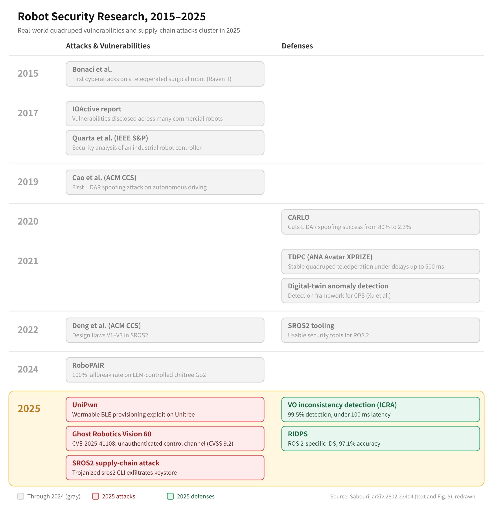
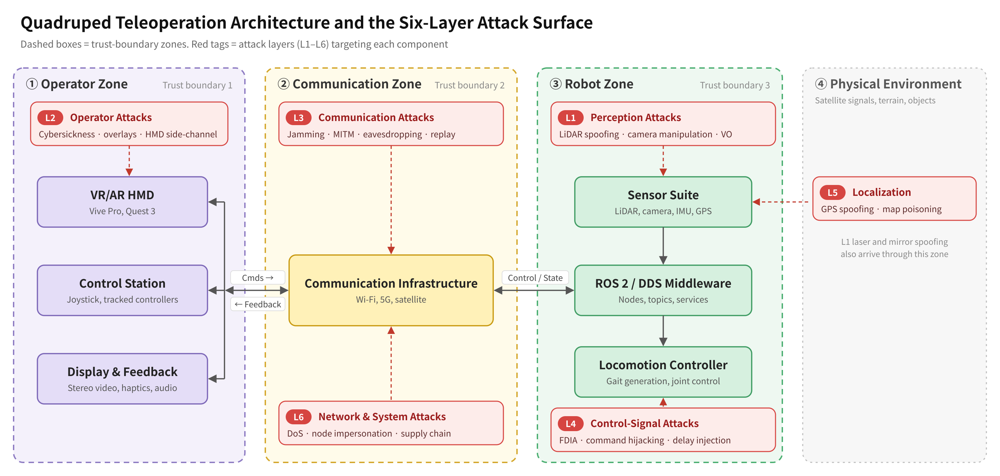
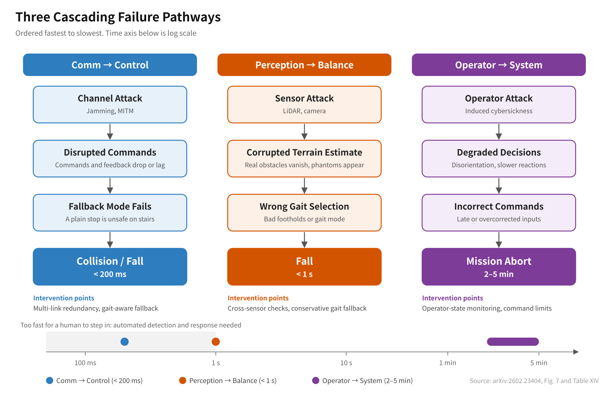
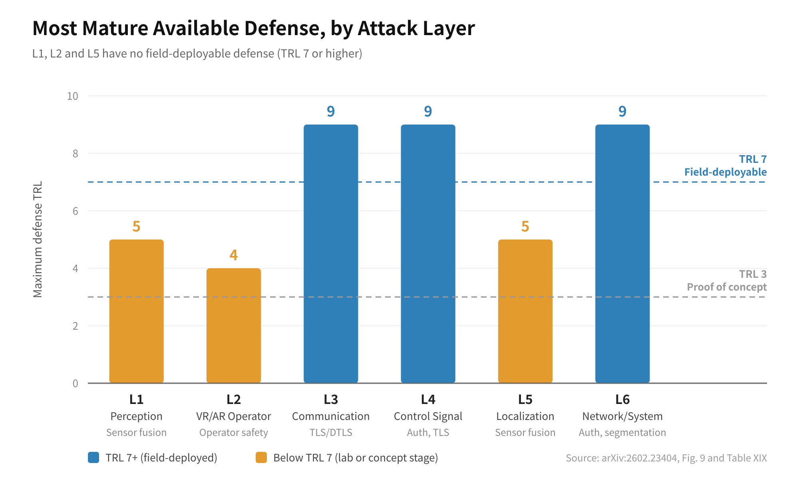

| Item | Details |
| --- | --- |
| Title | Cybersecurity of Teleoperated Quadruped Robots: A Systematic Survey of Vulnerabilities, Threats, and Open Defense Gaps |
| Author | Mohammad Sabouri (University of Genoa, DIBRIS) |
| Published | arXiv:2602.23404, 2026-02-26 (preprint; no conference or journal listed) |
| Length | 23 tables, 9 figures, ~130 references |
| Link | <https://arxiv.org/abs/2602.23404> |

This is the first survey I read as I started studying robot security. It collects the security problems that arise when you **teleoperate** a quadruped robot (robot dogs such as Spot or the Unitree Go2). I organized my notes around six questions:

1. What is the background of this paper?
2. What is the threat model?
3. What are the core ideas?
4. How does it differ from prior work?
5. So, what is the paper ultimately trying to say?
6. What did I find lacking?

---

## 1. Background

Quadruped robots are moving quickly into settings where failure is expensive: industrial inspection, military reconnaissance, explosive ordnance disposal, and disaster response. During 2025, a series of serious vulnerabilities were disclosed on real platforms.

- **UniPwn (Unitree)**: BLE provisioning used a hardcoded AES key shared across devices and did not validate the Wi-Fi credential input, allowing command execution as root. It was demonstrated as a worm that spreads to other robots within BLE range.
- **Ghost Robotics Vision 60 (military)**: The MAVLink-based control channel had no encryption or authentication, so an attacker on the same network could impersonate the operator tablet (CVE-2025-41108, CVSS 9.2).
- **RoboPAIR**: Jailbreaking the safety guardrails of an LLM-controlled Go2 succeeded 100% of the time.

Meanwhile, existing robot security surveys focused on industrial arms, drones, and autonomous vehicles. Problems specific to teleoperating a legged robot had never been organized in one place. To fill that gap, the author collected 2019–2025 literature plus CVEs and vendor disclosures using a PRISMA-style process (847 database hits → 130 final sources).

_Robot security research over time. Commercial quadruped vulnerabilities and supply-chain attacks cluster in 2025._

(I redrew this based on the paper's Figure 5 and main text.)

---

## 2. Threat Model

### 2.1 Adversary Model

The adversary is defined as a four-element tuple.

$$
\mathcal{A} = \langle \mathcal{C}, \mathcal{K}, \mathcal{O}, \mathcal{R} \rangle
$$

| Element | Meaning | Values |
| --- | --- | --- |
| $\mathcal{C}$ (Capability) | Capability tier | C1 opportunistic (remote, public exploits and default passwords), C2 sophisticated (proximity-based wireless injection, jamming, sensor spoofing; knows ROS2/DDS and BLE), C3 APT (supply-chain or firmware access, knows platform dynamics) |
| $\mathcal{K}$ (Knowledge) | What the attacker knows | System architecture, dynamic model, **gait parameters**, cryptographic keys |
| $\mathcal{O}$ (Objective) | Goal | disrupt / degrade / deceive / destroy / exfiltrate |
| $\mathcal{R}$ (Resource) | Access | Network, RF equipment, physical proximity, supply-chain position |

What stands out is that **gait parameters** appear in the knowledge set. The attacker in this paper is assumed to know which leg the robot is lifting right now and to time the attack accordingly.

### 2.2 Trust Boundaries and Assumptions

The system is split into four zones: ① the operator environment (HMD, control station), ② the communication channel (wireless links, edge/cloud relays), ③ the robot's onboard computing (ROS2 graph, middleware, controllers), and ④ the physical environment (sensors, actuators, terrain). The paper's view is that **every boundary crossing is an attack surface where cyber actions turn into physical consequences.**

There is one key assumption: the attacker has no direct physical access to the robot during operation and acts only through wireless interfaces, cloud services, and the electromagnetic environment (RF injection, interference).

### 2.3 Six-Layer Attack Taxonomy

STRIDE is mapped onto the following six layers.

| Layer | Target | Representative attacks | Numbers worth noting |
| --- | --- | --- | --- |
| L1 Perception | LiDAR, camera, VO | Injecting phantom LiDAR obstacles / removing real ones, faking stereo depth, passive mirror spoofing | LiDAR spoofing 75–92% (on autonomous vehicles) |
| L2 VR/AR operator | **The human** | Inducing cybersickness (8–25 Hz flicker, optic-flow manipulation), HMD side channels, fake overlay injection | 60–80% of VR users experience cybersickness |
| L3 Communication | Wireless links | Jamming (constant/reactive/deceptive/sweep/pilot), MITM, eavesdropping | Below 4 dB SJR, Wi-Fi packet error rate is effectively 100% |
| L4 Control signal | Command stream | FDIA, replay, command hijacking, delay injection | χ² residual detectors catch replay only 35–75% of the time (at 5% false alarms) |
| L5 Localization | GNSS, odometry, maps | GPS spoofing, leg-odometry corruption, SLAM map poisoning | 82% success for off-road deviation attacks |
| L6 Network/System | ROS2/DDS, firmware | Topic flooding, node impersonation via DDS discovery, supply chain (trojanized sros2 package) | 643+ DDS services exposed to the internet (34 countries) |

_Teleoperation components and where each attack layer hits. Dashed boxes are trust boundaries._

(I redrew Figure 4 because the original was hard to read.)

### 2.4 Why L2 (the VR/AR Operator Layer) Stands on Its Own

The most striking part of this taxonomy is L2.

**How it was handled before.** Earlier robot security taxonomies usually split layers by **machine-side components** such as hardware, communication, and software (e.g., Yaacoub et al. 2022). Teleoperation security research likewise focused on attacks against the **channel and control loop**, such as DoS, FDIA, and replay. The operator was treated as a "user" outside the system, at most someone whose credentials could be stolen. Cybersickness was classified as a VR usability or human-factors issue, not a security one. In fact, in the paper's comparison with prior surveys (Table X), every prior survey is marked ✗ for VR/AR attacks.

**What exactly L2 is.** Attacks that use the VR/AR interface to **target the operator's perception, physiology, and judgment**. There are three kinds.

| Attack | Method | Supporting numbers |
| --- | --- | --- |
| Cybersickness induction | 8–25 Hz flicker, fake optic flow (vection) that creates a false sense of self-motion, mismatching vision and the vestibular sense (balance), field-of-view perturbation, latency jitter | NATO recommends at least 90 Hz and under 20 ms motion-to-photon latency to prevent cybersickness |
| HMD side channels | Inferring information from head-motion data alone | 82% top-5 word accuracy for keystroke inference, over 90% gesture recognition (USENIX Security 2023) |
| Display content injection | Inserting fake overlays that look like real telemetry | Fake waypoints, fake battery or overheating warnings, falsified pose and velocity readouts |

**Why it matters.** In teleoperation, the human is part of the control loop. So the attacker does not need to break into the robot's software stack at all. Disorient the operator or deceive the display, and the operator issues late or overcorrected commands, and the robot falls. Quadrupeds need constant small corrections on stairs, so the effect is especially strong.

There is also an asymmetry in consequences. In the paper's severity table (Table XV), cybersickness induction is rated **"none" for robot damage but "high" for human and mission impact**. A platform-centric security framework would deprioritize it because the robot itself is not harmed. The author splits the operator into its own layer to make exactly this point.

Defenses are not safe either. Cybersickness detectors can themselves be fooled with adversarial examples. Kundu et al. (2025) degraded LSTM-based detection accuracy by 4.65× and Transformer-based detection by 5.94×.

One clarification: an L2 attack still needs some access path to the video stream or operator-side software (e.g., MITM on video, a compromised VR client). What is new about L2 is **not the access path, but the fact that the target is a human.**

---

## 3. Core Ideas

Being a survey, the paper proposes no new algorithm. Instead, three analytical frames run through the whole paper.

### 3.1 The Physics of Walking Changes the Outcome of an Attack

The same attack has much worse consequences on a quadruped, for four reasons.

1. **Dynamic stability**: A wheeled robot stays upright when it stops, but a quadruped has to keep balancing at 100–1000 Hz just to stay standing. On stairs, a 50 ms delay alone can make it miss the swing→stance transition and fall.
2. **Kinetic energy**: A 50 kg robot moving at 3 m/s carries about 225 J, roughly the same as dropping a 15 kg object from 1.5 m.
3. **Gait-phase vulnerability windows**: During the swing phase, when a leg is lifted, the support polygon shrinks and the stability margin is small. An attacker who times an attack to this window can knock the robot over with a very small disturbance. Shi et al. (RSS 2024) showed that ANYmal-class RL locomotion controllers collapse under low-magnitude multi-modal adversarial inputs.
4. **The emergency-stop paradox**: The E-stop, the safest default action for other robots, causes an **uncontrolled fall** for a quadruped climbing stairs. The defensive action itself becomes the hazard.

> In the end, a "safe state" in this paper is not a single fixed state. **It depends on which gait phase the robot is in right now.** The later research gaps (gait-phase-aware IDS, phase-specific recovery control) all start from here.

### 3.2 Mapping Attack → Consequence in Terms of Time

The paper does not just list attacks. It organizes **how fast** each attack turns into a physical consequence as a cascading pathway.

| Pathway | Flow | Time to consequence |
| --- | --- | --- |
| Perception → Balance | Sensor attack → corrupted terrain estimate → wrong gait selection → fall | Under 1 s |
| Operator → System | Cybersickness → degraded judgment → incorrect commands → mission abort | 2–5 min |
| Comm → Control | Jamming/MITM → disrupted commands → fallback mode fails → collision or fall | Under 200 ms |

No human can intervene in a pathway that ends in a fall within one second. That is why the conclusion states that **automated detection and response are needed, not operator-driven incident handling.**

_Pathways ordered from fastest to slowest. The two that finish within one second leave almost no room for a human to step in._

(I redrew Figure 7 because the original was hard to read.)

#### The Cross-Layer Coordinated Attack Scenario

The most impressive part is a scenario that uses these pathways **at the same time**. Note up front that this is not a demonstrated attack but a hypothetical scenario constructed by the author.

1. Enter the internal network through the Go2's BLE vulnerability (L6) and lie dormant. Instead of attacking right away, watch the robot's state.
2. Wait for the moment the robot starts climbing stairs. This is where the stability margin is smallest and where an E-stop would actually cause a fall.
3. Launch three attacks at once.

| Attack | What it does | Why it goes unnoticed | What breaks |
| --- | --- | --- | --- |
| **Remove only the railing from the LiDAR point cloud (L1)** | Applies a "removal attack," which deletes the points of a specific object from the point cloud, to the railing | It touches only a peripheral structure, not the stairs themselves, so the terrain model still looks plausible | The robot's terrain model sees more traversable space than there really is. The railing also disappears from the operator's display, which is built from the same perception output |
| **Add 150 ms of latency to the operator's VR video (L2)** | Delivers the video the operator sees 0.15 s late | It looks like ordinary network jitter | The operator sees the robot wobble late and reacts late |
| **Inject a small FDIA into joint-velocity commands (L4)** | Injects a tiny error into commands at the swing→stance transition | It stays within the normal sensor-noise envelope, so residual-based detectors miss it | Foot touchdown timing drifts slightly off |

**The reason for launching all three together** is that each one removes one of the three safety margins a quadruped relies on to stay upright.

- Normally, if touchdown timing drifts a little (L4), the robot recomputes where to step based on its **terrain perception**. But that terrain model is already wrong (L1).
- If something still looks off, the **operator** can see it and stop or change direction. But the operator is watching video that is 0.15 s late (L2).

In the paper's words, the robot's world model becomes slightly overconfident, the operator becomes slightly slower and less certain, and the gait controller is nudged toward slightly mistimed contact. Each is only "slight," but the effect compounds multiplicatively rather than additively. So the probability of a fall rises sharply at the most dangerous moment (on the stairs).

From a detection standpoint, each attack stays below the threshold of its own layer's detector. The perception checker, the network latency monitor, and the control residual detector each conclude that everything is normal. **Even with good detection at every individual layer, this attack is not caught.** That is why the author proposes **cross-layer correlation analysis**, which checks whether weak anomaly signals from different layers line up in time, as a research task (Gap 7).

### 3.3 Evaluating Defenses by Maturity (TRL)

The author criticizes prior surveys for putting lab ideas and field-deployed technology on the same line. So every defense is classified into three tiers using the NASA/DoD Technology Readiness Level (TRL).

| Tier | TRL | Examples |
| --- | --- | --- |
| Field-deployed | 7–9 | TLS/DTLS, X.509/JWT authentication, firmware signing, FHSS, multi-link redundancy, network segmentation |
| Lab-validated | 4–6 | ML-IDS, CARLO (LiDAR spoofing 80% → 2.3%), **TDPC** (stable up to 500 ms delay; the only defense validated on a real quadruped), VO inconsistency detection, ASCON |
| Exploratory/conceptual | 1–3 | Digital twins, Zero-Trust, MTD, runtime verification, federated-learning IDS, gait-signature authentication |

This is quantified as a per-layer Security Readiness Index (SRI).

$$
\text{SRI}_\ell = \frac{\max_{d \in \mathcal{D}_\ell} \text{TRL}(d)}{7}
$$

The result: L3, L4, and L6 score 1.29 (deployment-ready), L1 and L5 score 0.71, and L2 scores 0.57. The overall harmonic mean is 0.88, **below deployment-ready**. In short, the communication channel can be protected with today's technology, but **the perception, operator, and localization layers have no field-ready defense at all.**

_The TRL of the most mature defense for each layer. Below each bar is the representative defense behind that value._

(I redrew Figure 9 because the original was hard to read.)

---

## 4. How It Differs from Prior Work

| Axis | Prior surveys (Botta 2023, Verma 2025, Yaacoub 2022, etc.) | This paper |
| --- | --- | --- |
| Scope | Robots in general (industrial arms, drones, mobile robots) | Limited to **legged locomotion + teleoperation** |
| Unit of analysis | Lists of attacks and vulnerabilities | Attack → **consequence + time to consequence** + cascading pathways |
| Defense evaluation | Describes techniques | **Separates maturity using TRL** |
| Operator | Barely covered | **VR/AR operator as its own attack layer (L2)** |
| Platforms | General discussion | Scores six commercial platforms (Spot, Unitree, Ghost, ANYmal, CyberDog, X30) based on CVEs |

The author builds a "Domain Specificity Index (DSI)" to show the difference. Prior surveys have a quadruped-relevant literature ratio of 0.02–0.03, while this paper claims 0.52.

The commercial platform scores are Spot 8.8, ANYmal 7.2, CyberDog 3.8, Unitree 2.2, and Ghost 2.2. I liked the analysis that the same 2.2 means different things. Ghost is a military platform with no basic authentication, while Unitree has structural flaws spread across an entire consumer product line. Recomputed with safety weighting, Ghost drops to 1.4.

Another difference is that the paper asks **why existing security goes unused**. ROS2 has SROS2/DDS-Security, but it is often left disabled in real deployments because the following tasks are tedious:

- Issuing a certificate for every participant
- Writing governance/permissions XML
- Distributing the CA
- Rotating and revoking keys

On top of that come the SROS2 design flaws found by Deng et al. (CCS 2022): V1 incomplete permission revocation, V2 weak namespace isolation, and V3 topology exposure during discovery. The 2025 sros2 CLI supply-chain attack adds to the list. The author's conclusion is **"deployment hygiene before new technology."**

---

## 5. So, What Is the Paper Ultimately Trying to Say?

Compressed into one line:

> **Security in quadruped teleoperation ultimately comes down to whether the robot falls, yet the defenses we have today are concentrated on the outer channel rather than where you could intervene before a fall (perception, the operator, and inside the control loop).**

Spelled out:

1. **Threat model**: Because of dynamic stability, gait phases, kinetic energy, and operator workload, quadrupeds have a fundamentally different attack–consequence profile from other robots. They cannot hover like drones, and they cannot just stop like wheeled robots.
2. **Consequence analysis**: Perception and control attacks lead to a fall within one second. So detection and response must be automated by the system, not handled by a human.
3. **State of defenses**: The layers that most need automated response (L1, L2, L5) are stuck at TRL 3–5. The mature defenses (TLS, authentication), on the other hand, mostly protect L3 and L4.
4. **Structural cause**: Autonomous vehicles have UNECE WP.29, drones have FAA regulation, and industrial robots have IEC 62443. Quadrupeds have no such external pressure. That is why security varies from 2.2 to 8.8 depending on vendor choices.
5. **Prescription**:
   - Short term: Properly turn on what already exists (authentication, DDS-Security, disabling BLE, network segmentation).
   - Medium term: Build **gait-phase-aware** IDS, physics-based FDIA detection, and phase-specific recovery control that replaces the E-stop.
   - The first prerequisite for all of this is a **quadruped-specific IDS dataset**.

Of the eight research gaps, Gaps 1–3 are top priority (gait-phase-aware IDS, real-time FDIA detection, and stability-preserving recovery control under attack). The paper also gives target numbers for Gap 1: detection latency under 250 ms (half a gait cycle for a 2 Hz trot), false-positive rate under 1% per gait phase, over 90% detection for L4 attacks, and under 10% CPU usage.

---

## 6. What I Found Lacking

### 6.1 Most of the Numbers Come from Other Domains

The author admits it too: only 15 sources (Grade A) are directly validated on quadrupeds. The rest come from autonomous vehicles, drones, and general CPS (74 Grade B) and vendor documents and CVEs (42 Grade C). The 75–92% LiDAR spoofing figure comes from roof-mounted automotive LiDAR and static-target experiments, and the "expected transfer to quadrupeds" column in Table XIII is essentially the author's estimate. That is understandable for a survey, but as the numbers get cited repeatedly, they start to read as if they were measured on quadrupeds.

### 6.2 The Evaluation Metrics Rely on a Single Assessor's Judgment

The TRL classification, platform scores (0–10), and research-gap priorities are all **the judgment of one author**. The author states that inter-rater reliability (Cohen's κ) was not measured. The CVE deductions in the platform score (Critical −3, High −2, Medium −1) also come without justification. The overall direction (Spot highest, Unitree and Ghost lowest) is convincing, but I think the decimal-level values should be read with less weight.

### 6.3 How SRI Is Computed

SRI divides each layer's maximum TRL by 7, so it can exceed 1 (L3, L4, L6 = 1.29). Taking the harmonic mean then lets **the surplus of the deployment-ready layers partly offset the deficient layer (L2 = 0.57).** But "L3 is very well protected" does not cancel out "L2 is not protected." Using the minimum, or capping each value at 1, would fit the paper's own argument (the weakest layer is the problem) better.

Also, L6 (platform) becomes "deployment-ready" at TRL 9 because of network segmentation and firewalls. Yet the representative L6 examples in this paper are firmware and supply-chain attacks such as UniPwn, and the defense against them, firmware signing (TRL 8), is actually deployed only on Spot. L6 readiness looks overstated.

### 6.4 The Threat Model Is Defined but Not Used Through to the End

The paper carefully defines the $\langle \mathcal{C}, \mathcal{K}, \mathcal{O}, \mathcal{R} \rangle$ tuple and the C1–C3 tiers, but the later attack taxonomy and defense evaluation contain almost no analysis along the lines of "this defense stops C2 but not C3." The only thing actually used is the STRIDE → layer mapping table. A matrix of defense coverage by adversary tier would have tied in better with the practitioner guidance in Section 8.

The "no physical access during operation" assumption is also slightly inconsistent, since the same paper treats the Ghost Vision 60's unauthenticated physical ports (CVE-2025-41109) as a major vulnerability.

---

## Further Reading

- G. Deng et al., *On the (In)Security of Secure ROS2*, ACM CCS 2022: SROS2 design flaws V1–V3
- F. Shi et al., *Adversarial Attacks on Learning-based Quadrupedal Locomotion Controllers*, RSS 2024: empirical evidence of gait-phase vulnerability
- H. Kwon & J. Ueda, *FDIA and Detection in Bilateral Teleoperation Using Lie Group Theory*, IEEE TCST 2024: conditions for undetectable FDIA
- M. Risiglione et al., *Passivity-Based Control for Quadrupedal Robot Teleoperation* (TDPC): the only defense validated on a quadruped
- INCIBE-CERT, Ghost Robotics Vision 60 advisory (CVE-2025-41108/41109/41110)