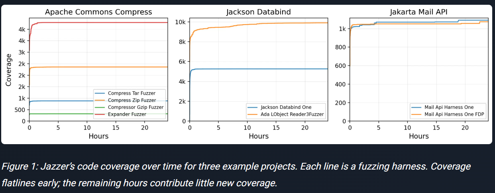
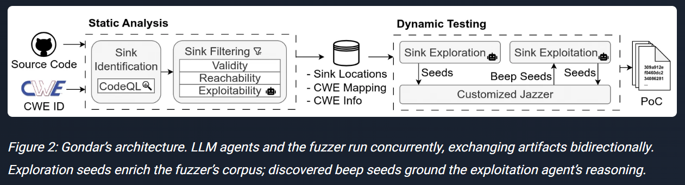
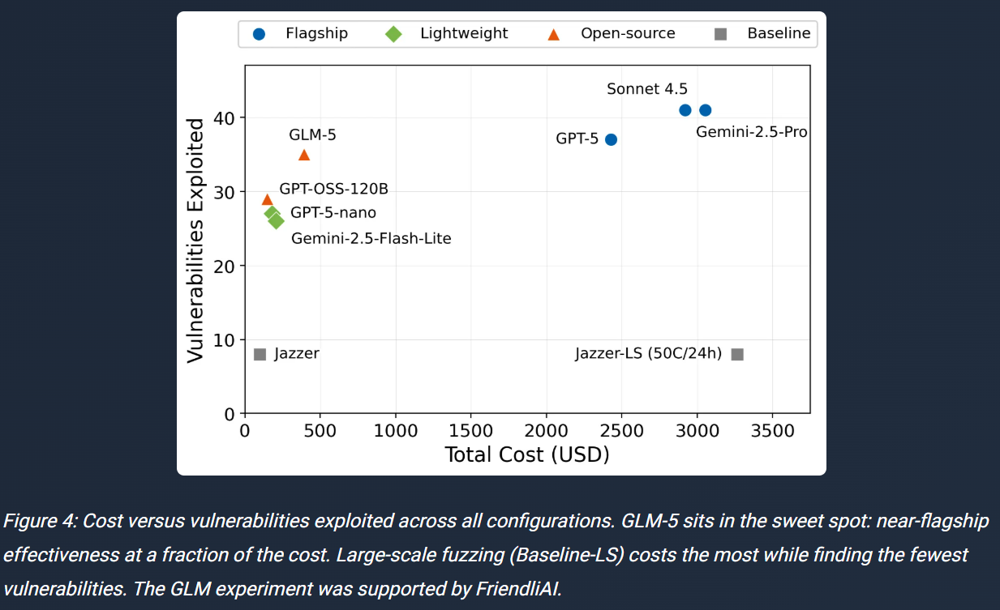

## Intro

I recently played in two CTFs. I leaned on Claude heavily in both, and honestly, I used it **without much thought** — I handed it the challenge files and said "solve this."

- **ACDC**: I spent four hours and barely solved a single problem (with Claude).
- **AutoHack**: I solved about six. Early on they fell quickly. Because it was going well, I opened multiple terminals and ran Claude in parallel — and in the second half, **nothing got solved at all.**

Some problems were solved instantly, some took forever, and some never cracked. But I couldn't explain *why* the difference happened.

Around the same time, OpenAI announced GPT-6 Cyber. According to the [announcement](https://openai.com/index/introducing-gpt-6-cyber/), the model developed 948 Linux kernel privilege-escalation exploits and found 81 new high-severity vulnerabilities in Firefox. People around me say they do bug bounty "with one click of AI," and I fail even at that, every time.

So this post is me trying to work out what I did wrong. My sources are the blog posts from Team Atlanta — the DARPA AIxCC winners led by Prof. Taesoo Kim — plus other articles and papers on the same topic.

> This is not a post claiming I found the answer. It's closer to a memo of what I understand so far and what I plan to try next.
{: .prompt-info }

---

## 0. Look at the Conditions Behind the Numbers First

My first reaction to the GPT-6 Cyber results was "why can't I do this?" But when you look closely at the announcement, the conditions are completely different.

- **A dedicated pipeline**: The kernel work wasn't a human typing prompts. A dedicated system of scout agents and analyst agents swept roughly 5,000 security-relevant locations in the kernel, then narrowed them through a funnel: candidates → verification in isolated VMs → exploits.
- **Budget**: Reporting puts the total cost at around $1.21 million.
- **Model**: It's a restricted, security-specialized model that regular users can't access.
- **Verification**: Every figure is OpenAI's own. There's no independent verification yet.

So what I was comparing myself against was never "an AI." It was **a designed system + automated verification + a huge budget.** Admitting I picked the wrong comparison is where I have to start.

---

## 1. Even the AI Didn't Solve Every CTF Problem

> 📄 [Hacking Redefined: How LLM Agents Took on University Hacking Competition](https://team-atlanta.github.io/blog/post-tkctf-2024/) (Team Atlanta, 2024.12)

Team Atlanta entered their AIxCC system, Atlantis, directly into Georgia Tech's internal CTF (TKCTF 2024). There were 12 challenges, each with about a 4-hour limit. The result was **10 vulnerabilities found and 7 patches generated.**

What caught my attention was the **problems it missed.**

- It found most of the memory-safety bugs.
- But it missed the logic bug in the two-sum challenge. The author explains it this way: ["Atlantis was tuned to prioritize memory safety issues"](https://team-atlanta.github.io/blog/post-tkctf-2024/) — meaning Atlantis was built from the start to prioritize memory-safety problems.
- On puzzle-style challenges like the maze and shellcode-golf, the patches changed the intended behavior.

Let me pin down how the two kinds of bugs differ.

- **Memory-safety bugs** come from a program mishandling memory — buffer overflows (writing past the allotted size), use-after-free (reusing freed memory), and so on. These leave **visible signals** like crashes or sanitizer warnings, so they're easy to catch automatically.
- **Logic bugs** are cases where the memory is fine but the program's judgment is wrong. The program doesn't die; it quietly returns a wrong answer, so it's hard to catch automatically.

AIxCC weighted heavily toward finding memory bugs in C and Java projects, and Atlantis was built for that competition. So missing the logic bug isn't surprising.

**My takeaway:** Even a system built by dozens of people was **biased toward the direction it was designed for.** So my one-line "solve this" Claude obviously has types it's good at and types it isn't. My sense that "some problems solve instantly and some never do" wasn't a coincidence. The thing is, I never recorded which types were which. That's my first regret.

(For the record, this post says all 7 patches were "fully sound" while elsewhere noting that 3 challenges couldn't be patched soundly — the two don't quite reconcile. It's better to read these results critically rather than take them at face value.)

---

## 2. More Terminals Won't Solve More Problems

> 📄 [More CPUs Won't Find More Bugs: Insights from Combining LLM Agents and Jazzer](https://team-atlanta.github.io/blog/post-sinkfuzz-glm/) (Team Atlanta, 2026.4)

This is the post that best explained the second half of my AutoHack.

First, the experimental setup.

- **The test set**: Team Atlanta prepared **54 vulnerabilities** for evaluation, drawn from 22 open-source Java projects, mixing real CVEs, AIxCC challenges, and manually injected bugs. Think of it as 54 exam questions with known answers.
- **The two configurations compared**: The Java fuzzer Jazzer run small (3 cores for 12 hours per target) versus large (50 cores for 24 hours per target).
- **Resources spent**: The post's figure is a total of **7.2 CPU-years.** One CPU-year is the compute of one CPU core running non-stop for a year. 7.2 CPU-years means they split work that would take one core over seven years across many cores.

The result: both configurations successfully exploited the **same 8** of the 54. Throwing dozens of times more resources at it solved zero new problems.

To understand this, you need the idea of a **sink** — a function that performs a dangerous operation, like running a system command or executing a DB query. If external input flows into it, problems can arise. Exploiting one vulnerability takes two stages:

1. **Reach**: the input has to actually flow to that dangerous function.
2. **Exploit**: after reaching, you have to produce the intended effect.

The large configuration did stage 1 (reach) for 3 more sinks, but the number making it to stage 2 didn't increase at all. Running more gets you a bit closer to the door, but you still can't open it.

_Figure 1. Jazzer's code coverage over time. It flatlines early. Source: [Team Atlanta](https://team-atlanta.github.io/blog/post-sinkfuzz-glm/)_

The failures split into two groups.

- 46% of vulnerabilities were **never even reached.**
- 39% were reached but **couldn't be turned into an exploit** (the authors call this the "last-mile" problem).
- For half the targets, 95% of the final coverage was reached **within 15 minutes.**

The authors' diagnosis is short: ["It's a semantic gap."](https://team-atlanta.github.io/blog/post-sinkfuzz-glm/) What was missing wasn't resources but the **ability to understand meaning.**

So instead of running the fuzzer bigger, they attached **role-divided LLM agents** (Gondar): an agent that picks dangerous spots, an agent that analyzes the path to reach them, and an agent that develops reached inputs — each doing its own job while exchanging artifacts with the fuzzer in both directions.

_Figure 2. Gondar's architecture. LLM agents and the fuzzer run concurrently, exchanging artifacts bidirectionally. Source: [Team Atlanta](https://team-atlanta.github.io/blog/post-sinkfuzz-glm/)_

The result was 41 of 54 in the best configuration. Removing the exploration agent dropped reached vulnerabilities from 42 to 29; removing the exploitation agent dropped exploited ones from 37 to 18. An open-source model (GLM-5) delivered about 85% of flagship performance at a fraction of the cost. The point: **design matters as much as model size.**

_Figure 4. Cost versus vulnerabilities exploited across configurations. Source: [Team Atlanta](https://team-atlanta.github.io/blog/post-sinkfuzz-glm/)_

**My takeaway:** What I did in the second half of AutoHack was exactly "add more cores." I just spun up more Claudes doing the same thing ("solve this"), without looking at where it was stuck — whether it failed to reach, or reached but couldn't finish the last mile. And the more windows I had open, the less I could track each one's progress. What I increased was resources; what I decreased was my own judgment.

---

## 3. "AI Alone Isn't Enough"

> 📄 [AIxCC Final and Team Atlanta](https://team-atlanta.github.io/blog/post-afc/) (Taesoo Kim, 2025.8)

It's a victory retrospective, but it's more about **attitude** than flashy tech. Here's what I took from it.

1. **AI alone isn't enough.** Prof. Kim argues LLMs don't replace classic program analysis. Tools like fuzzers and concolic executors first had to be heavily re-engineered to run at real-world scale. In the post's words: ["AI alone isn't enough"](https://team-atlanta.github.io/blog/post-afc/).
2. **You need a verifier (an oracle).** Ensembling agents or leaning on LLM creativity only helps when something can judge correctness — a crash, a sanitizer, a Proof-of-Vulnerability check.
3. **Specialization beats generality.** Several narrow agents beat one broad agent, and for focused tasks a smaller model sometimes beat a larger one.
4. **LLMs are powerful but unpredictable.** So don't trust vendor claims — measure them yourself — and design for failure. Running several independent systems of different designs (N-version) is part of why.

**My takeaway:** In the CTFs, my only "oracle" was the flag. Until a flag appeared, I had no way to know whether Claude's words were right or wrong, so I bled time on plausible-sounding explanations. For each problem I need to decide, **up front, on a signal I can check at intermediate stages.**

The principle is simple: write down, **in a form I can verify with my own eyes,** what "if this succeeds, I can move to the next step" means. Some examples by category:

- **Reversing**: When Claude says "this function validates the input," I set a breakpoint there in a debugger and check whether my input actually reaches it. When it says "the check logic is this," I reimplement that logic in Python and compare it against the original binary on the same inputs. Only after both pass do I ask it to reverse the operation.
- **Crypto**: When Claude proposes an attack, I first build a **small example I know the answer to** and check that the method recovers it. Only after the small example works do I move to the real problem.
- **Web**: If source is given, I spin up the same server locally and first confirm that the endpoints and behavior Claude described actually exist. Then I check whether the hypothesis holds by watching changes in responses or logs.

Three common rules:

1. **One claim from Claude, one check.** When it says "it's like this," I get the command or script to verify it alongside.
2. **Build the local environment first.** Working only against the remote means that when something fails, I can't tell where it broke.
3. **Don't advance until a checkpoint passes.** The four hours I spent in ACDC were probably because I kept stacking the next hypothesis on top of an unverified one.

---

## 4. Making the AI Work Like a Security Researcher: The MLLA Series

> 📄 [MLLA: Teaching LLMs to Hunt Bugs Like Security Researchers](https://team-atlanta.github.io/blog/post-mlla-overview/) (2025.8)
> 📄 [From Harness to Vulnerability: AI Agents for Code Comprehension and Bug Discovery](https://team-atlanta.github.io/blog/post-mlla-disc-agents/) (2025.9)
> 📄 [BCDA: The AI Detective Separating Real Bugs from False Alarms](https://team-atlanta.github.io/blog/post-mlla-bcda/) (2025.9)
> 📄 [Context Engineering](https://team-atlanta.github.io/blog/post-context-engineering/) (2025.9)

MLLA is an experiment in letting an LLM drive the entire vulnerability-discovery process. Its structure splits things up along **the order a human researcher works in.**

| Agent | What it does | If it were a human |
|---|---|---|
| CGPA | Tracks functions, files, dependencies | Drawing the code map |
| CPUA | Picks entry points that take untrusted input | "Where do I start looking?" |
| MCGA | Builds the call graph, marks dangerous spots (sinks) | Following the data flow |
| BCDA | Investigates suspects, filters false positives, writes structured reports | "Is this a real bug?" |
| BGA | Writes input-generation scripts | Building the trigger |

What matters in this order is that **"understand → hypothesize → verify" is separated.** [From Harness to Vulnerability](https://team-atlanta.github.io/blog/post-mlla-disc-agents/) covers the code-comprehension work that must happen before any attack. [The BCDA post](https://team-atlanta.github.io/blog/post-mlla-bcda/) is about making a separate agent for the step of filtering real bugs out of plausible candidates. [Context Engineering](https://team-atlanta.github.io/blog/post-context-engineering/) argues that the more precision a task needs, the more **what context you give the LLM, and how,** decides the outcome.

[The MLLA overview](https://team-atlanta.github.io/blog/post-mlla-overview/) is also honest about the problems of putting an LLM front and center.

- **Cost**: Thousands of LLM calls get expensive fast, so they optimized prompts and cached.
- **Speed**: LLMs are slow versus fuzzing, so they ran parallel and asynchronous.
- **Hallucination**: More LLM use means more confident errors, so they added validation and cross-checking.
- **Context limits**: Complex bugs need a lot of context, so they used compression.

One thing that struck me: even when MLLA didn't produce the final crash itself, its intermediate outputs (bug hypotheses, branch conditions) helped the overall system.

**My takeaway:** I crammed all five of these stages into one sentence ("solve this"). That makes Claude do comprehension, hypothesis, and verification all at once, with no visibility into which stage went wrong. And I kept none of the intermediate outputs from any stage.

---

## 5. Other People Are Saying the Same Thing

This isn't just Team Atlanta's story. Sources of very different kinds point to similar conclusions.

### Sean Heelan: Choosing the Context Is the Skill

> 📄 [How I used o3 to find CVE-2025-37899, a remote zeroday vulnerability in the Linux kernel's SMB implementation](https://sean.heelan.io/2025/05/22/how-i-used-o3-to-find-cve-2025-37899-a-remote-zeroday-vulnerability-in-the-linux-kernels-smb-implementation/) (2025.5)

Heelan audited the kernel's ksmbd using only the o3 API. In his words, ["no scaffolding, no agentic frameworks, no tool use"](https://sean.heelan.io/2025/05/22/how-i-used-o3-to-find-cve-2025-37899-a-remote-zeroday-vulnerability-in-the-linux-kernels-smb-implementation/). Unpacked:

- **no scaffolding**: no helper program to auto-split the task or feed results back in.
- **no agentic frameworks**: no agent system like Claude Code where the model plans and executes multiple steps on its own.
- **no tool use**: the model didn't run code, search files, or use a debugger itself.

So he pasted code in and just asked over the API. Instead, he **chose the code to feed the model himself** — trimming specific SMB command handlers and related functions to fit within the token limit. When he widened the scope to all command handlers (about 12,000 lines), performance dropped due to scale, but a new use-after-free (CVE-2025-37899) surfaced in the process.

Even without a framework, the result came from **a human deciding what to show.** The exact opposite of me throwing in the whole challenge file.

### Sean Heelan: There Are Conditions for Work That Pays Off

> 📄 [On the Coming Industrialisation of Exploit Generation with LLMs](https://sean.heelan.io/2026/01/18/on-the-coming-industrialisation-of-exploit-generation-with-llms/) (2026.1)

Heelan argues that for a task to reach the state of "put in tokens, get out results," you need two things.

1. The agent needs **an environment and tools to search for a solution** without human help.
2. There needs to be **a way to verify** a solution, and that verifier must be accurate, fast, and not involve a human.

Conversely, he adds that this scaling is hard for tasks where, in a real environment, a single wrong action ends the search.

By this standard, my experience splits cleanly. The problems that solved instantly probably already had both conditions in place. The ones that didn't were ones where I provided neither the environment nor the verifier. Bug bounty is even more extreme: the target is a live service, a human (the triager) is in the verification loop, and out-of-scope actions aren't allowed. It's the hardest possible environment for "one-click."

### Google Project Zero: Naptime's Design Principles

> 📄 [Project Naptime: Evaluating Offensive Security Capabilities of Large Language Models](https://projectzero.google/2024/06/project-naptime.html) (Sergei Glazunov, Mark Brand, 2024.6)

Project Zero laid out principles for making an LLM work like a human researcher — **iterative and hypothesis-driven**: space to reason, an interactive environment, specialized tools, perfect verification, and a sampling strategy of trying many times. This framework later became Big Sleep.

Compared with Team Atlanta, **the structure is different.**

- **Naptime** is basically **one agent** that iterates from start to finish using tools (code browser, debugger, script execution).
- **Team Atlanta** splits the work into stages and **hands each stage to a specialized agent**, combining that with traditional tools like fuzzers. Prof. Kim's "specialization over generality" is exactly this difference.

Still, **they share the principles.** Both have the model run things in a real environment and verify. Both treat the verifier as central (Naptime's "perfect verification" and Atlantis's "oracle" are the same idea). And both expect not to hit it in one shot, trying many times. Whether the agent is one or many, these three never drop out.

### Papers: Why Naive Use Fails

> 📄 **PentestGPT: Evaluating and Harnessing Large Language Models for Automated Penetration Testing** — [USENIX Security 2024](https://www.usenix.org/conference/usenixsecurity24/presentation/deng)

LLMs are **good at sub-tasks** — using tools, interpreting output, proposing the next action — but they fall apart at maintaining the overall testing context. The authors split reasoning, generation, and parsing into separate modules to reduce this. It reminded me of Claude, while I sat on one problem for four hours, forgetting what it had figured out earlier and repeating the same attempts.

> 📄 **EnIGMA: Interactive Tools Substantially Assist LM Agents in Finding Security Vulnerabilities** — [ICML 2025](https://arxiv.org/abs/2409.16165)

Letting a CTF agent use **interactive tools** like a debugger or server connection improved performance substantially — because with tools, the model can base its next judgment on **what actually happened.**

The paper also reports the opposite case: *soliloquizing*, where the model **invents observations** without actually interacting with the environment — writing out the imagined output of a command it never ran. One reason to hand the model tools is precisely to prevent this: real observations are what push out fake ones.

Applied to my experience: when Claude said "I ran it and here's the result," I never checked whether it actually ran it or imagined it. And after I opened several windows, I couldn't check at all.

> 📄 **ATLANTIS: AI-driven Threat Localization, Analysis, and Triage Intelligence System** — [arXiv 2509.14589](https://arxiv.org/abs/2509.14589) (Team Atlanta technical report)

---

## 6. So What Will I Change

The common thread I took away is three things.

1. **Split it up**: separate understand → hypothesize → verify.
2. **Verify**: build a signal you can check mid-way, not just the flag.
3. **The human judges**: I decide what to show and I see where it's stuck.

Based on this, here's what I'll try in the next CTF and in practice.

- [ ] **I scout for the first 10 minutes of each problem.** I lay out the binary's protections, the I/O shape, and the suspicious spots myself, and hand that memo in as context (the Heelan approach).
- [ ] **Instead of "solve this," I assign it step by step.** "Explain only the input flow of this function," "Give three vulnerability candidates with evidence," "Write only a script that reproduces candidate 1 locally" (MLLA, PentestGPT).
- [ ] **I decide the verification signal first.** I pick what counts as "progress" — local reproduction, a crash, a specific output — and have the model run it and confirm (Naptime; the oracle from Prof. Kim's post).
- [ ] **I hand it runnable tools.** I run it in an environment where the model can use a debugger or remote connection directly (EnIGMA).
- [ ] **I keep state in a file.** I have it log confirmed facts and hypotheses separately in a `notes.md`, and when stuck, I hand only that file to a fresh session (PentestGPT's answer to context loss).
- [ ] **Parallel means "one per problem, only as much as I can watch."** I don't clone the same approach; I give each window a different problem or a different role (analysis, reproduction) (More CPUs).
- [ ] **I record solved vs. unsolved problems by type.** I gather my own data on where my tooling is biased (TKCTF).

For bug bounty, verification is much harder than in CTF, so I think I need to change my approach. Rather than running AI on any program, I'll try an **"my judgment + AI amplification"** approach after I've understood the area myself.

---

## 7. What I Still Don't Know

- Whether these methods actually work **in my environment and budget** — I haven't tested yet. I plan to add results to this post after the next competition.
- Team Atlanta's and OpenAI's results came from large teams and budgets. There's no guarantee the principles at that scale carry over to an individual scale.

The conclusion I reached: I'm not bad at using AI. I just **expected results without creating the conditions under which AI can produce them.**

---

## References

**Team Atlanta blog**
- [Hacking Redefined: How LLM Agents Took on University Hacking Competition](https://team-atlanta.github.io/blog/post-tkctf-2024/)
- [More CPUs Won't Find More Bugs: Insights from Combining LLM Agents and Jazzer](https://team-atlanta.github.io/blog/post-sinkfuzz-glm/)
- [AIxCC Final and Team Atlanta](https://team-atlanta.github.io/blog/post-afc/)
- [MLLA: Teaching LLMs to Hunt Bugs Like Security Researchers](https://team-atlanta.github.io/blog/post-mlla-overview/)
- [From Harness to Vulnerability: AI Agents for Code Comprehension and Bug Discovery](https://team-atlanta.github.io/blog/post-mlla-disc-agents/)
- [BCDA: The AI Detective Separating Real Bugs from False Alarms](https://team-atlanta.github.io/blog/post-mlla-bcda/)
- [Context Engineering: How BGA Teaches LLMs to Write Exploits](https://team-atlanta.github.io/blog/post-context-engineering/)

**Articles**
- Sean Heelan, [How I used o3 to find CVE-2025-37899](https://sean.heelan.io/2025/05/22/how-i-used-o3-to-find-cve-2025-37899-a-remote-zeroday-vulnerability-in-the-linux-kernels-smb-implementation/)
- Sean Heelan, [On the Coming Industrialisation of Exploit Generation with LLMs](https://sean.heelan.io/2026/01/18/on-the-coming-industrialisation-of-exploit-generation-with-llms/)
- Sergei Glazunov, Mark Brand (Google Project Zero), [Project Naptime](https://projectzero.google/2024/06/project-naptime.html)
- OpenAI, [GPT-6 Cyber](https://openai.com/index/introducing-gpt-6-cyber/)

**Papers**
- G. Deng et al., [PentestGPT](https://www.usenix.org/conference/usenixsecurity24/presentation/deng), USENIX Security 2024
- T. Abramovich et al., [EnIGMA](https://arxiv.org/abs/2409.16165), ICML 2025
- T. Kim et al., [ATLANTIS](https://arxiv.org/abs/2509.14589), Technical Report, 2025

> All figures in this post are from the Team Atlanta blog, with the source noted under each.
{: .prompt-tip }